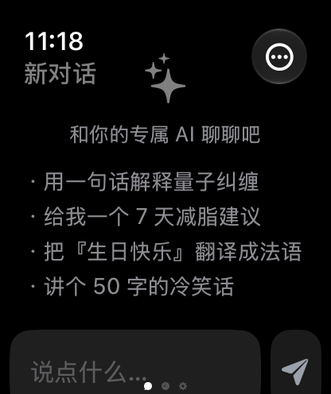
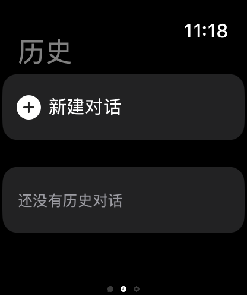
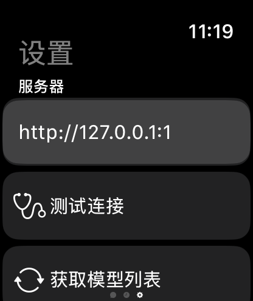

# Ollama for Watch

<p align="center">
  
  
  
</p>

在 Apple Watch 上连接内网 **Ollama** / 兼容 **OpenAI Chat Completions** 的服务并与模型对话。  
单文件 SwiftUI 实现，编译目标 **watchOS 26.x**，**Swift 5.0**，严格并发 + MainActor 隔离。

---

## 功能

### 对话

- **流式响应**：逐 token 推送，AI 一边输出用户一边看（默认开启）
- **Markdown 渲染**：AI 回复里的 `` `代码` `` / `*斜体*` / `**加粗**` / `[链接]` 自动渲染
- **打字光标 + Typing indicator**：流式输出时光标闪烁，等待时三点跳动
- **时间戳**：每条消息下方显示发送时间，可在设置里关闭
- **重试上一条**：菜单里一键重发最后一条 user 消息
- **停止生成**：流式过程中右侧按钮变成红色停止按钮
- **快捷 prompt**：新建对话时显示 4 个示例问题，点击填入输入框
- **分享消息**：左滑消息气泡调用系统 `ShareLink`，通过 AirDrop / Messages / Mail 转发
- **删除消息**：右滑消息气泡即可删除该条
- **自动滚动到最新**：新消息到来时自动滚到底部，可在设置里关闭

### 历史

- **新建 / 加载 / 删除 / 重命名** 对话
- 滑动操作（watchOS 侧滑）支持快速删除和重命名
- 显示消息条数 + 最后更新时间

### 设置

- 服务器地址（自动 trim 末尾斜杠）
- **测试连接**：GET `/` 验证服务器可达
- **获取模型列表**：显示大小、更新时间等元信息
- 选择模型（持久化）
- **系统提示词**：可编辑，每次发送注入
- 切换：自动滚动、显示时间戳
- **清空全部历史**（带确认）

---

## 使用

1. 打开「设置」页，填入 Ollama 服务器地址，例如 `http://192.168.1.100:11434`
2. 点击「测试连接」确认服务器可达
3. 点击「获取模型列表」，在下拉菜单中选择你想用的模型
4. 切到「对话」页，输入文字或使用听写即可开始对话

> 手表需要与 Ollama 服务器处在同一局域网。  
> 如果用 ngrok / Cloudflare Tunnel 等内网穿透，请填公网 HTTPS 地址。

---

## 本地构建

需求：

- macOS + **Xcode 26**（项目用 Xcode 26.3 创建，File System Synchronized Groups 特性）
- watchOS 部署目标 **26.2**
- 一台 Apple Watch（watchOS 26.x）或 Simulator

步骤：

1. 克隆本仓库
   ```bash
   git clone <repo-url>
   cd WatchOllamaClient
   ```
2. 用 Xcode 打开 `ollama_client for watch/ollama_client for watch.xcodeproj`
3. 选择 Watch App scheme + 你的 Apple Watch / Simulator
4. **重要**：首次打开后，把 Bundle Identifier 改成你自己的（如 `com.you.ollama-watch.watchkitapp`），否则 `xcodebuild` 会因为签名冲突构建失败
5. ⌘R 运行

> 项目无第三方依赖，纯 `Foundation` + `SwiftUI` + `Combine` + `os.log`。

---

## 项目结构

```
.
├── ollama_client for watch/
│   ├── ollama_client for watch.xcodeproj/
│   │   ├── project.pbxproj
│   │   └── project.xcworkspace/
│   ├── ollama-client-for-watch-Watch-App-Info.plist
│   └── ollama_client for watch Watch App/
│       ├── ollama_client_for_watchApp.swift   # 全部源码（单文件）
│       └── Assets.xcassets/                    # AppIcon + AccentColor
└── readme.assets/                              # README 截图
```

`ollama_client_for_watchApp.swift` 内部分层（按 MARK 划分）：

| MARK | 内容 |
| --- | --- |
| 0 | 全局配置 / 工具（URLSession、String、错误枚举） |
| 1 | 数据模型（ChatMessage / ChatSession） |
| 2 | 网络层 OllamaClient（health / fetchModels / chatOnce / streamChat） |
| 3 | 持久化 ChatHistoryStore |
| 4 | 业务逻辑 OllamaManager（@MainActor ObservableObject） |
| 5 | 视图（ContentView / ChatView / HistoryView / SettingsView） |
| 6 | App 入口 `@main OllamaWatchApp` |

---

## 工程说明

- 单一 Swift 文件 + 单 Info.plist，便于拷贝
- **MainActor 隔离**：项目设置 `SWIFT_DEFAULT_ACTOR_ISOLATION = MainActor`，所有 UI 状态默认在主线程
- `OllamaClient` 是 `Sendable struct`，纯网络层不依赖 ViewModel
- `OllamaManager` 是 `@MainActor final class ObservableObject`，通过 `@AppStorage` + `@Published` 暴露状态
- `ChatHistoryStore` 是 `Sendable struct`，封装 UserDefaults 读写，便于将来换成文件 / CoreData
- `OllamaError: LocalizedError, Equatable`，便于 catch 时 pattern match

### 关键实现要点

- **URL 规范化**：`String.trimmedForURL` 自动去除首尾空白和末尾 `/`，避免拼接出 `http://x:11434//api/tags` 的 404
- **流式响应**：用 `URLSession.bytes(for:)` + `bytes.lines` 解析 NDJSON，逐 token 通过 `@MainActor` 闭包回推
- **流式 Task 取消**：识别 `CancellationError` / `URLError(.cancelled)` / `OllamaError.cancelled` 三种情况，收尾时给消息加 `（已停止生成）` 标记
- **TypingIndicator**：用 `.task { while !cancelled ... }` 替代 `Timer.scheduledTimer`，避免 view 消失后定时器泄漏
- **JSONDecoder**：`fetchModels` 设置 `.iso8601` 解码 Ollama 返回的 RFC3339 时间字符串
- **持久化版本化**：历史 key 从 `chatHistories` → `chatHistories.v2`，附带 `createdAt` / `updatedAt` / `systemPrompt` 等字段
- **Info.plist**：开启 `NSAllowsLocalNetworking` + 提供 `NSLocalNetworkUsageDescription` 让 watchOS 同意访问内网；声明麦克风 / 听写权限说明以启用听写输入

### watchOS 适配笔记

watchOS 不暴露 `UIPasteboard` / `TextEditor` / `Menu` / `keyboardType` 等 API，因此本项目做了以下替代：

- 复制文本 → 改用 `ShareLink(item:)` 通过系统分享面板转发
- 多行编辑系统提示词 → 改用 `axis: .vertical` 的 `TextField`
- 操作菜单 → 改用 `confirmationDialog` 弹窗

---

## 协议

MIT License. 详见 [LICENSE](./LICENSE)（如仓库未附带，请自行添加）。

## 致谢

- [Ollama](https://ollama.com/) — 让本地跑大模型变得简单
- 截图均来自 watchOS Simulator（Apple Watch Series 11, 46mm）
